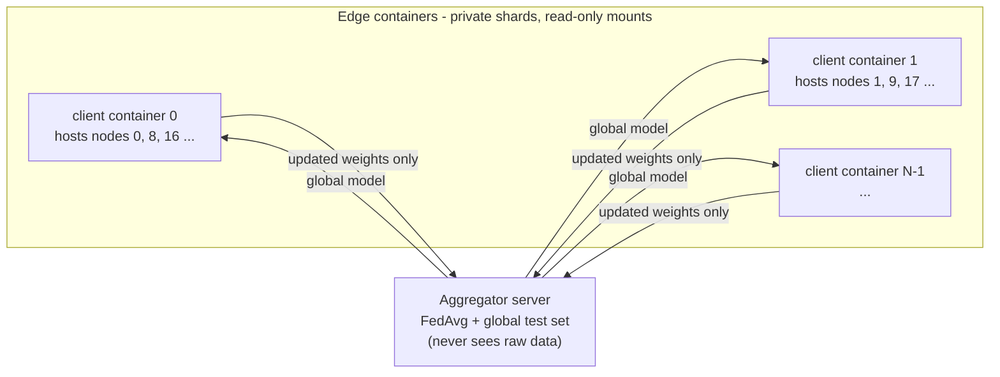

# FedSwarm - Week 1: Federated Edge Network + Baseline FedAvg

**Project 2 - Privacy-Preserving Federated Swarm Intelligence** (Zaalima Development, DS & ML track)

> Hospitals, clinics and phones all hold data that is too sensitive to pool in one place
> (HIPAA, GDPR, India's DPDP Act 2023). Federated learning lets them train **one shared model
> while the raw data never leaves the device**. Week 1 builds the network and the baseline;
> Weeks 2-4 add homomorphic encryption, differential privacy and poisoning defence.

Try it on real medical images: `DATASET=bloodmnist docker compose up --build`
(blood-cell classification across simulated "hospitals").

## Architecture



* `data-prep` splits the dataset into **non-IID private shards** (`data/nodes/`).
* The **server container mounts only the test set**; the shards are mounted **only into clients**.
* One container hosts several *logical* nodes (node `n` lives in container `n % NUM_CONTAINERS`),
  so a laptop can simulate **hundreds of nodes with ~8 containers**.
* Clients poll the server (no inbound connections to edge nodes). The server validates every
  update (shape, names, NaN/Inf) before it is aggregated.

## Week 1 deliverables -> where they are

| Requirement (project document) | Implemented in |
|---|---|
| Virtualized edge-device network with Docker Compose, hundreds of isolated client nodes | `docker-compose.yml`, `fedswarm/cli/client.py` (`NUM_NODES`, `NUM_CONTAINERS`) |
| Highly non-IID dataset distributed across nodes | `fedswarm/partition.py` (Dirichlet / shards / IID), `fedswarm/cli/prepare_data.py` |
| Baseline Federated Averaging with a central aggregator | `fedswarm/aggregation.py`, `fedswarm/coordinator.py`, `fedswarm/training.py` |
| GitHub: daily commits, own branch, CI | `COMMIT_PLAN.md`, `.github/workflows/ci.yml`, `docs/WORK_DISTRIBUTION.md` |

Mid-review checks covered this week: *simulated edge-node network operational and holding
localized data* and *baseline FedAvg successfully syncing weights*. (Encrypted aggregation is Week 2.)

## Quick start

### A. Without Docker (fastest way to see it work)

```bash
python -m venv .venv && source .venv/bin/activate        # Windows: .venv\Scripts\activate
pip install torch torchvision --index-url https://download.pytorch.org/whl/cpu
pip install -r requirements-dev.txt

pytest -q                                                 # unit tests
python -m fedswarm.cli.simulate --dataset synthetic --num-nodes 20 --rounds 5   # offline sanity check

# the real thing: 200 nodes, non-IID vs IID control -> results/simulation_curves.png
python -m fedswarm.cli.simulate --dataset mnist --num-nodes 200 --rounds 30 --compare-iid
```

### B. Docker Compose swarm

```bash
docker compose up --build
# Windows/macOS: Docker Desktop must be running (WSL2 backend on Windows)
# live progress:  http://localhost:5000/status
```

Outputs land in `results/`: `partition_heatmap.png`, `history.csv`, `fedavg_curve.png`,
`summary.json` (final accuracy + total MB uploaded/downloaded - the start of Week 4's benchmark).

Scale it up / change the experiment (any of these can go in a `.env` file, see `.env.example`):

```bash
NUM_NODES=300 NUM_CONTAINERS=10 ROUNDS=40 ALPHA=0.1 docker compose up --build
DATASET=bloodmnist ALPHA=0.5 docker compose up --build
```

Each client container uses roughly 300-500 MB of RAM. If your laptop struggles, lower
`NUM_CONTAINERS` (the number of logical nodes stays the same).

## Understanding non-IID (what to show your reviewers)

`ALPHA` controls how skewed each node's labels are: `0.1` extreme, `0.3` strong, `1.0` mild,
`100` almost IID. `results/partition_report.json` stores proof numbers: average classes per node
and the mean total-variation distance from the global label distribution (0 = IID, 1 = disjoint).
Run `simulate --compare-iid` and the plot shows the **accuracy gap caused by non-IID data** -
the central problem of federated learning, and the motivation for FedProx (`--mu`) which is already
wired in as an optional extra.

## How it maps to Weeks 2-4

| Later requirement | Hook already in place |
|---|---|
| FHE (TenSEAL) aggregation | `aggregation.fedavg` is the single combine point; `serialization.py` is the single wire format |
| Differential privacy | `training.local_train` - clip/noise gradients there |
| Byzantine-fault-tolerant aggregation | `Coordinator.submit_update` already validates updates; swap the aggregator for a robust one |
| Benchmark vs centralized, dashboard | `history.csv` already logs accuracy, loss, MB up/down, seconds per round |
| CI/CD | `.github/workflows/ci.yml` runs tests + a smoke simulation on every push |

## Be ready to explain (review Q&A)

* **What is FedAvg?** Each selected node trains locally, the server averages the weights, weighted by
  how much data each node has: `w = sum(n_k / n * w_k)`. See `aggregation.fedavg`.
* **Why does the raw data stay private?** Only weights travel. The server container has no access to
  the shards (separate mounts). Note: weights can still leak information, which is exactly why
  Week 2 adds encryption and Week 3 adds differential privacy.
* **Why is non-IID hard?** Local models drift towards their own label mix, so averaged models converge
  slower and worse than with IID data.
* **Why no BatchNorm?** BN statistics are unreliable under non-IID data and awkward to aggregate/encrypt.
* **Why 8 containers for 100+ nodes?** Containers are heavy (~400 MB each), logical nodes are not.
  The isolation boundary that matters is *data*, and each node reads only its own shard.
* **How is it deterministic?** Seeds fix the partition, the node sampling per round, and local shuffling.

## Project layout

```
fedswarm/
  partition.py      Dirichlet / shard / IID splits + heterogeneity stats   (NumPy only)
  aggregation.py    FedAvg + deterministic node sampling                   (NumPy only)
  serialization.py  pickle-free weight transport (.npz)                    (NumPy only)
  coordinator.py    server round state machine + Flask API                 (torch-free, unit-tested)
  models.py  training.py  data.py  simulation.py  report.py  config.py
  cli/              prepare_data | simulate | server | client
tests/              partition, aggregation, server protocol, torch training
docker-compose.yml  Dockerfile  .github/workflows/ci.yml
```

## Troubleshooting

* **Port 5000 busy** (macOS AirPlay Receiver uses it): change `"5000:5000"` in `docker-compose.yml` to `"5050:5000"`.
* **Clients wait forever**: the server starts only after *all* `NUM_CONTAINERS` containers register. If you use
  `--scale client=N`, also set `NUM_CONTAINERS=N`.
* **Out of memory / containers killed**: lower `NUM_CONTAINERS`; raise Docker Desktop's memory limit.
* **`bloodmnist` fails to download**: it needs internet access inside the `data-prep` container.
