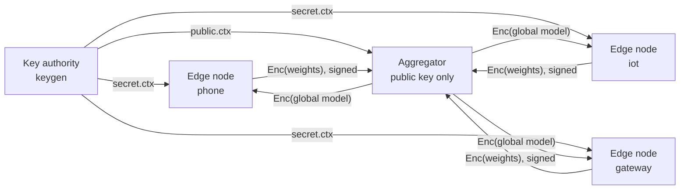

# SwarmShield - Privacy-Preserving Federated Swarm Intelligence (Weeks 1-2)

Federated learning over a simulated **swarm of heterogeneous edge devices** (phones, IoT sensors,
gateways). Raw data never leaves a device, and in encrypted mode the aggregator never sees a
plaintext weight: it averages **CKKS ciphertexts** (TenSEAL) with a public key only.



## Week 1 / Week 2 coverage

| Brief item | Where |
|---|---|
| Docker Compose network of hundreds of isolated client nodes | `scripts/gen_compose.py`, `Dockerfile` |
| Highly non-IID data across nodes | `swarm/data/partition.py`, `swarm/data/prepare.py` |
| Baseline FedAvg | `swarm/fl/aggregation.py` (`PlainAggregator`), `SWARM_MODE=plain` |
| TenSEAL FHE, weights encrypted before leaving the device | `swarm/crypto/ckks.py`, `swarm/node/client.py` |
| Aggregator averages directly on ciphertexts | `EncryptedAggregator`, `ckks.aggregate_weighted` |
| Strict commit rules + CI/CD, crypto peer-review gate | `scripts/check_commit_msg.py`, `.github/workflows/ci.yml`, `.github/CODEOWNERS`, `docs/GIT_WORKFLOW.md` |
| Mid-review: "ciphertext aggregation mathematically validated" | `scripts/validate_encrypted_aggregation.py` -> `reports/` |

## Quick start (no Docker needed)

```bash
make setup                       # venv + deps + git hooks
make data NODES=100 ALPHA=0.2    # non-IID shards + heterogeneity report + heatmap
make sim                         # plain vs encrypted FedAvg, in-process, writes runs/sim/
make validate                    # mathematical validation report -> reports/
make local-net                   # REAL aggregator + 12 node processes over HTTP (MODE=plain|fhe)
make test-all                    # 32 tests incl. real-process integration tests
```

## Container swarm

```bash
cp .env.example .env             # set SWARM_ENROLL_SECRET
make data NODES=100 ALPHA=0.2
make compose MODE=fhe ROUNDS=15  # or MODE=plain for the Week-1 baseline
make up                          # keygen -> aggregator -> 100 nodes; results in runs/latest/
```

`docker compose` quick demo: `make demo` (12 nodes). Measured node footprint is about 65 MB RSS,
so 100 nodes need roughly 7-8 GB RAM; scale `NODES` to your machine.
If you are on Apple-silicon and the `tenseal` wheel is unavailable for arm64, build with
`DOCKER_DEFAULT_PLATFORM=linux/amd64`.

## What is deliberately different from a textbook FL demo

1. **Capacity-aware Dirichlet partitioning.** Label skew *and* data volume follow device class
   (a gateway holds ~9x the data of an IoT sensor). Non-IID-ness is **measured** (Jensen-Shannon
   score, effective classes per node, size Gini) and written to `manifest.json` + a heatmap.
2. **Device-class swarm behaviour.** Per class: dropout probability, straggler slowdown, uplink
   bandwidth (to emulate big ciphertext uploads) and Docker CPU/RAM limits.
3. **Semi-synchronous rounds.** A round closes on full participation, or on quorum + straggler
   grace, or at the deadline; no quorum -> the attempt is discarded and a new sample is drawn.
   Weights are **renormalised under encryption** over whoever actually reported.
4. **Blind aggregator, enforced in code.** It refuses to start with a context containing a secret
   key; secret and public keys live in separate Docker volumes; plaintext uploads are rejected in
   encrypted mode; malformed / wrong-shape ciphertexts are rejected before aggregation.
5. **Federated evaluation.** The aggregator cannot decrypt, so it cannot score the model.
   Nodes decrypt the global model, score it on local validation data and report loss/accuracy;
   the aggregator computes the sample-weighted global accuracy.
6. **Signed uploads.** HMAC over (node, round, attempt, body) stops replay, tampering and
   cross-node spoofing.
7. **FedProx switch** (`SWARM_PROX_MU`) for harsher non-IID settings.
8. **Hardened node containers:** read-only FS, non-root, `cap_drop: ALL`, PID limit, one shard
   file mounted per node.
9. **Compliance tooling:** `scripts/commit_streak.py` audits daily commits;
   commit-msg hook enforces `type(scope): subject` and forces scope `crypto` on crypto changes.

## Measured results (from this repository's code)

* Encrypted vs plaintext FedAvg, 100 non-IID nodes (alpha=0.2), 15 rounds, identical seeds:
  final test accuracy **0.7211 vs 0.7211**; max weight drift ~8e-7.
* Real HTTP swarm (12 nodes, 4 rounds): both modes reach **0.4562** federated accuracy.
* Homomorphic aggregation error: ~1e-7 on O(1) weights, ~3e-6 on O(10) weights (tolerance 1e-5).
* Cost: a 4,522-parameter model is 36 KB in float64 and **663 KB** encrypted (about **18x**).

Re-generate all of it with `make validate` and `make sim`.

## Honest limitations (read `docs/SECURITY_MODEL.md`)

* One CKKS secret key is shared by all nodes (simulation shortcut; threshold/multiparty HE is the
  production answer). A compromised node can decrypt the global model - which every node sees
  anyway - and any ciphertext it can obtain.
* The aggregator still learns metadata: sample counts, eval metrics, participation, timing.
* FHE protects individual updates from the aggregator; it does **not** make the aggregate
  differentially private (Week 3) and it is **not** a zero-knowledge *proof* system.
* Transport is plain HTTP with HMAC auth: put TLS in front for anything beyond a lab.
* The Docker files were generated and YAML-validated but could not be executed in the
  environment this repo was authored in; the identical code path was exercised by the
  `local-net` integration tests (real aggregator + real node processes over HTTP).

## Layout

```
swarm/
  data/      datasets, capacity-aware Dirichlet partitioner, shard writer
  models/    numpy MLP with flat-vector interface (+ FedProx local SGD)
  fl/        FedAvg (plain + encrypted), deterministic client selection
  crypto/    CKKS codec, key authority, validation suite
  server/    coordinator (round state machine) + FastAPI aggregator
  node/      edge-node client + shared local trainer
  sim/       in-process simulator, local multi-process network runner
scripts/     compose generator, validation, commit policy, streak audit, hooks
tests/       32 tests (unit, crypto, adversarial protocol, integration, policy)
docs/        architecture, security model, git workflow, review checklist, daily plan
```
